# 🚦 West Yorkshire Traffic Analysis & Forensic Reporting


<p align="center">

  <!-- Data & Analysis -->
  
  
  

  <!-- Geo & Mapping -->
  
  

  <!-- App Framework -->
  

</p>

An interactive intelligence dashboard and automated reporting tool built to analyse road safety data across West Yorkshire. This project transforms raw government datasets into actionable insights using a modern Python stack.

---

## 📑 Table of Contents

- [Why This Project Exists](#-why-this-project-exists)
- [Screenshots](#-screenshots)
- [Project Architecture](#️-project-architecture)
- [Project Structure](#-project-structure)
- [Data Sources](#-data-sources)
- [Tech Stack](#-tech-stack)
- [Installation & Setup](#️-installation--setup)
- [Testing](#-testing)
- [Roadmap Features](#️-roadmap-features)

---

## 🎯 Why This Project Exists

I wanted a practical way to explore real-world data using Python while learning more about geospatial analysis, dashboard development, and automated reporting.

Using publicly available Department for Transport data, I focused on West Yorkshire and built a tool that turns raw collision records into interactive maps, visualisations, and forensic-style reports.

---

## 📸 Screenshots

- The dashboard includes statistical analysis, geospatial mapping, blackspot detection, and automated report generation for West Yorkshire road traffic incidents.

<details>
  <summary>click here</summary>

## 📊 Statistical Analysis
- Figure 1-10

- ### Collision Severity Distribution

- Displays the proportion of slight, serious, and fatal collisions across the West Yorkshire dataset, providing an overall view of incident severity.
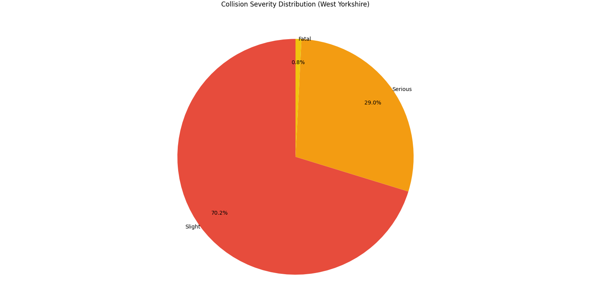

- ### Severity by District

- Compares the number of fatal, serious, and slight collisions across West Yorkshire districts, highlighting geographical differences in collision patterns.
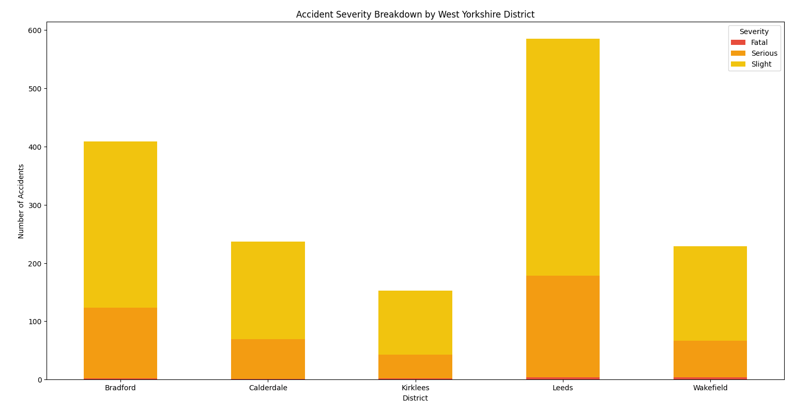

- ### Collisions by Hour of Day

- Displays the number of collisions recorded during each hour of the day across West Yorkshire.
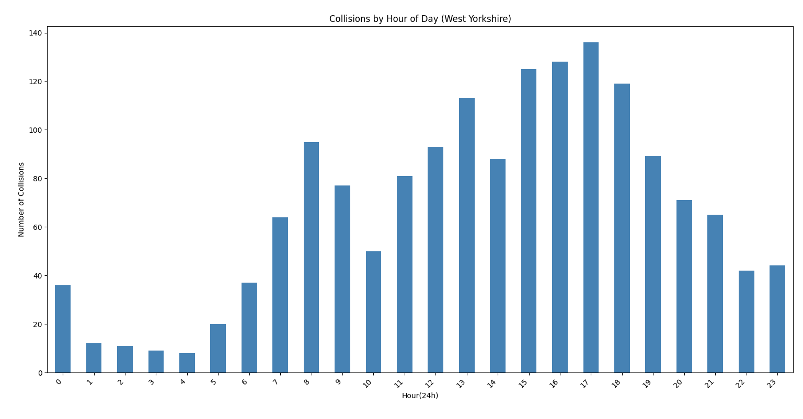

### Collisions by Weekday

- Displays the number of collisions recorded on each day of the week across West Yorkshire.
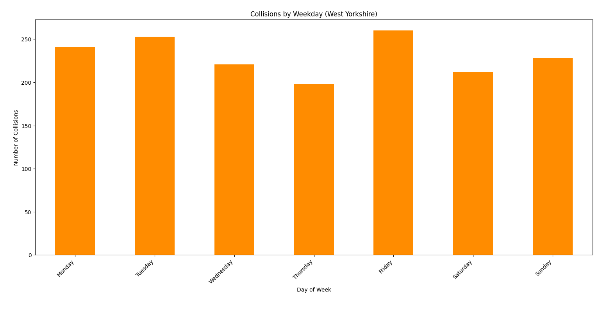

### Collisions by Month

- Displays the number of collisions recorded each month, highlighting seasonal trends across West Yorkshire
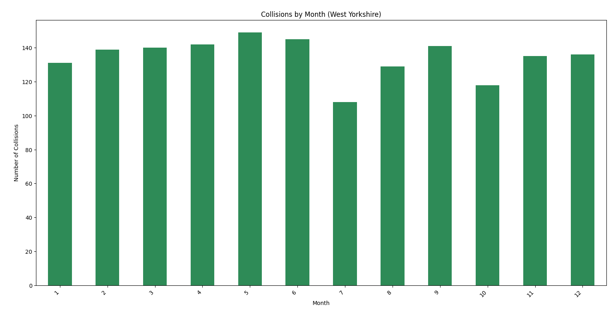

### Collisions by Road Type

- Displays collision totals by road type, showing where incidents occur most frequently across the road network.
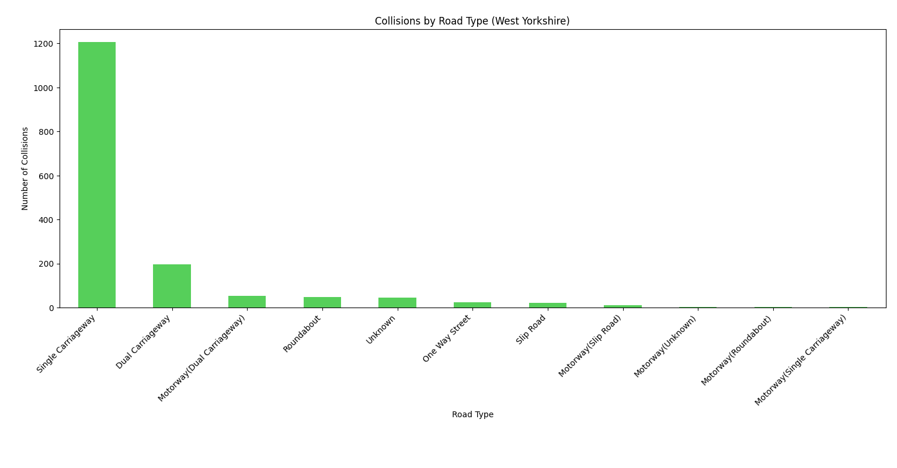

### Collisions by Speed Limit

- Displays collision totals across different speed limit categories within West Yorkshire.
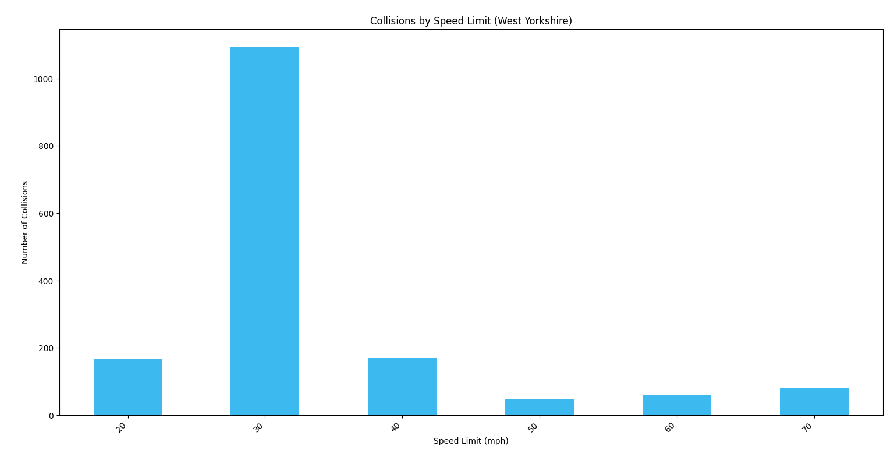

### Urban vs Rural Collisions

- Displays the proportion of collisions occurring in urban and rural areas across West Yorkshire.
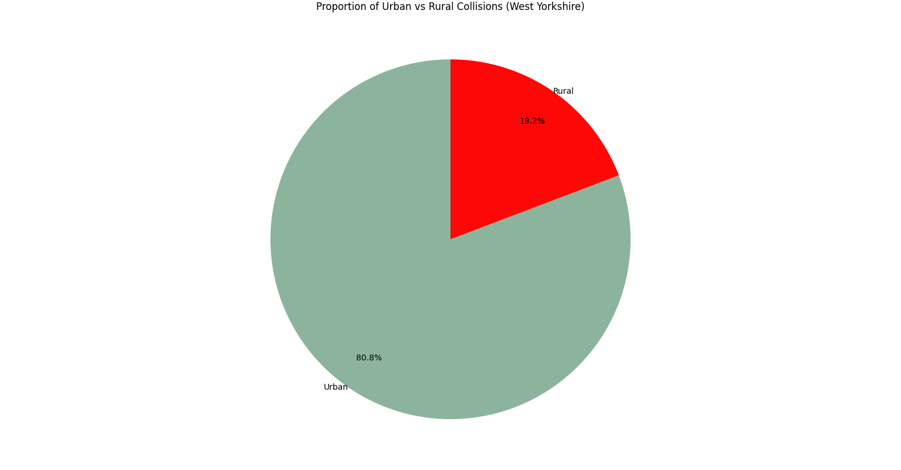

### Collisions by Weather Condition

- Displays collision totals across different weather conditions recorded in West Yorkshire.
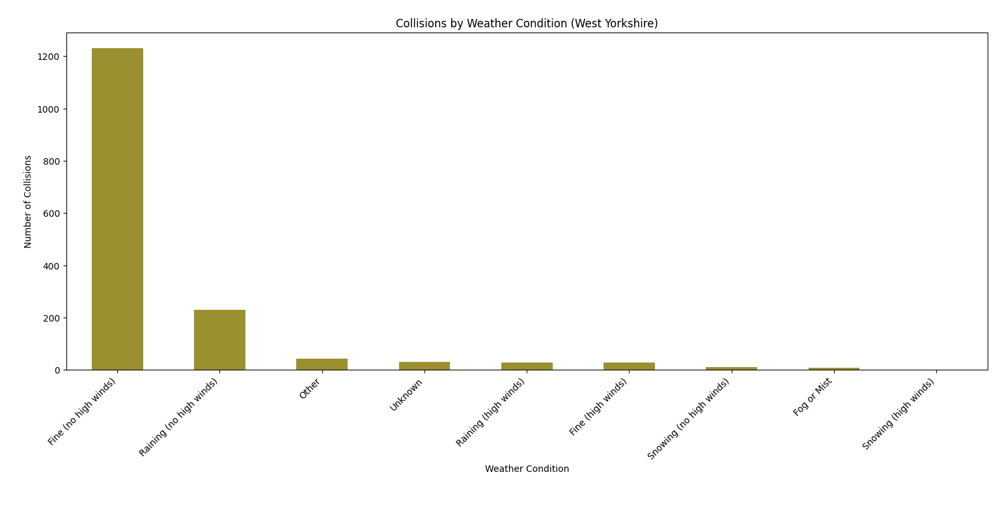

### Collisions by Light Conditions

- Displays collision totals across daylight and various darkness lighting conditions in West Yorkshire.
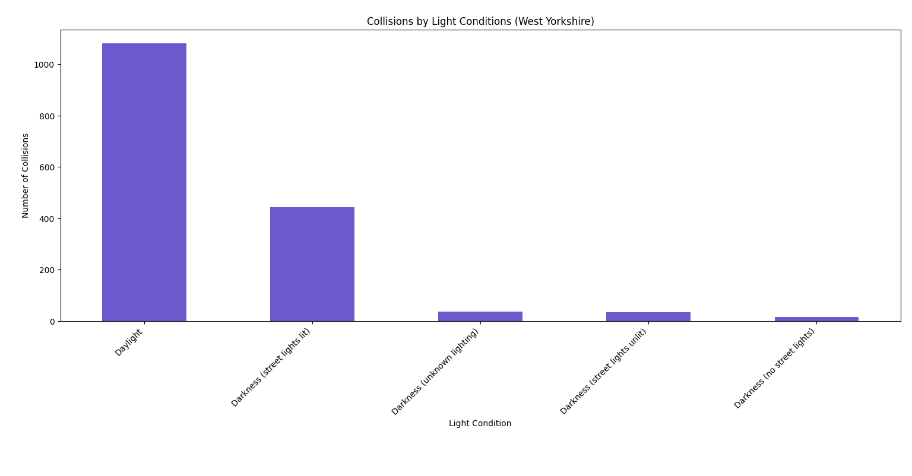

---

## ⚙️ Interactive Dashboard

### Dashboard Overview

- Displays the main dashboard interface, including summary metrics, interactive filtering controls, and geospatial analysis tools.
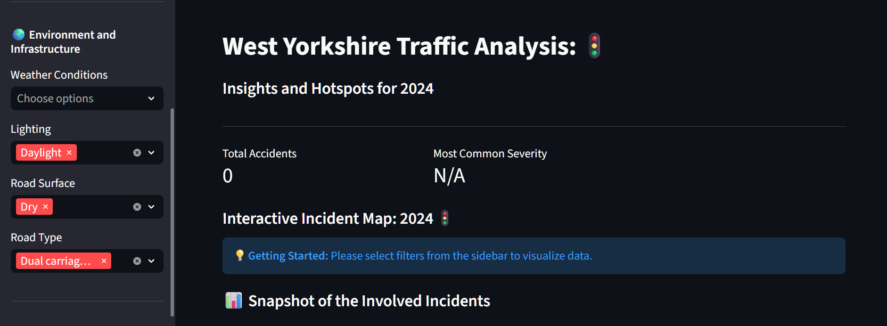

### 🗃️ Advanced Filtering

- Displays the sidebar filtering system, allowing incidents to be filtered by severity, casualty demographics, environmental conditions, and infrastructure characteristics.
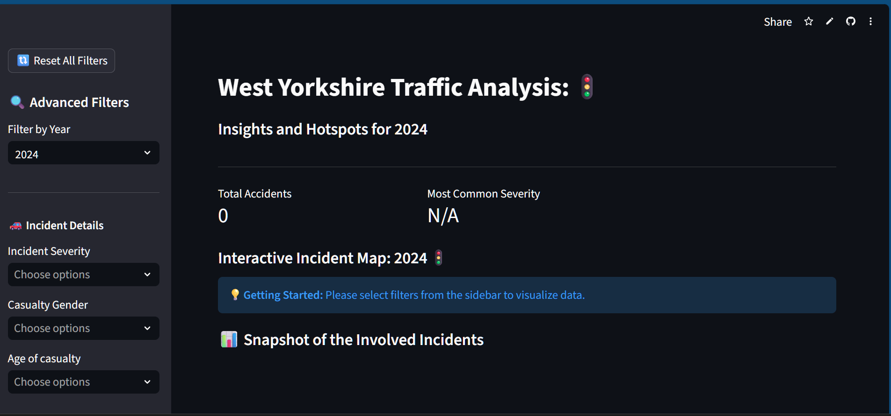

### Interactive Incident Mapping

- Displays the interactive Folium map with clustered collision hotspots and incident filtering for detailed geographical analysis.
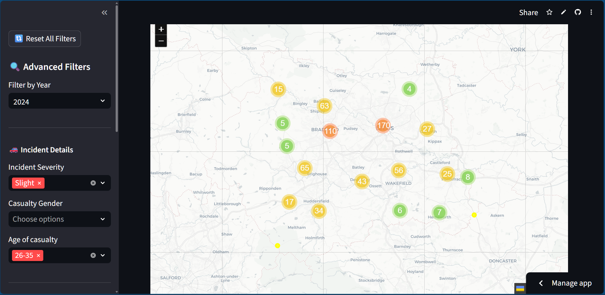

### Advanced Filtering Controls

- Displays the sidebar controls used to filter and explore collision data across multiple analytical categories.

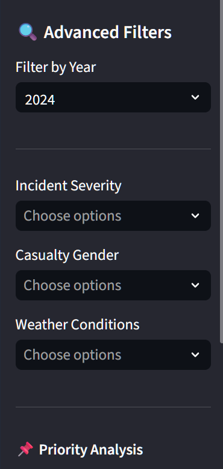

---

## 🔍 Geospatial Analysis & Mapping

### Collision Density Overview

- Displays collision clusters across West Yorkshire, using colour-coded markers to highlight low, medium, and high incident-density areas.
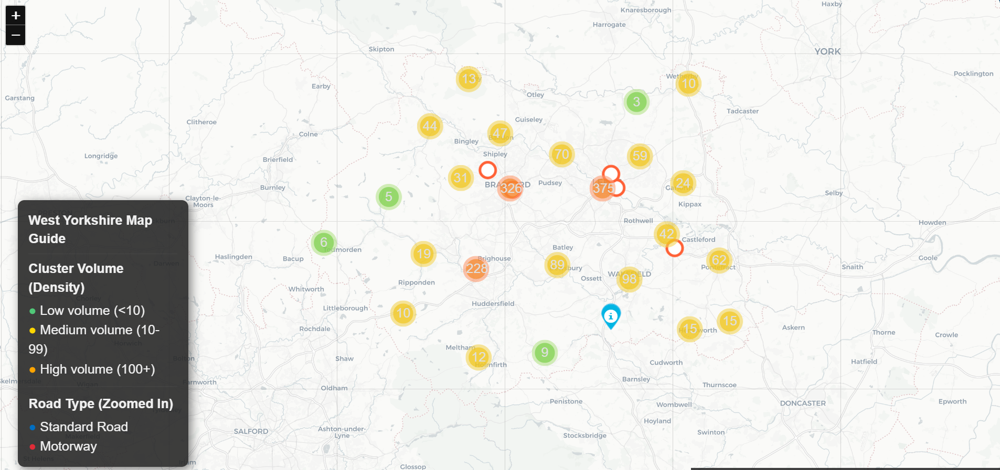

### Priority Blackspot Analysis

- Displays ranked high-risk locations, highlighting accident blackspots with geographic boundaries and detailed location information.
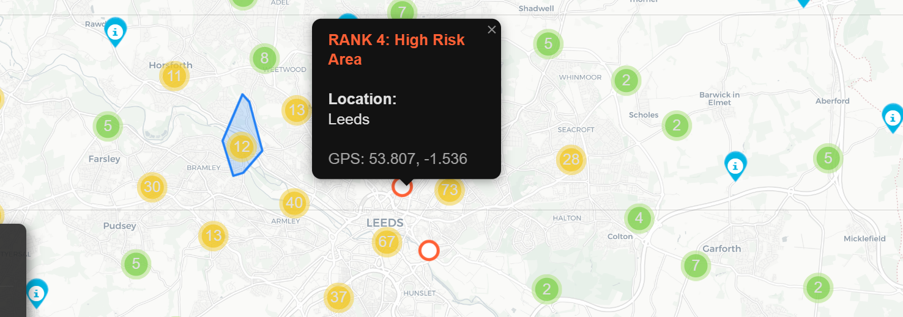

### Motorway Incident Analysis

- Displays motorway-related collisions with interactive incident details, supporting investigation of high-speed road networks and collision patterns.
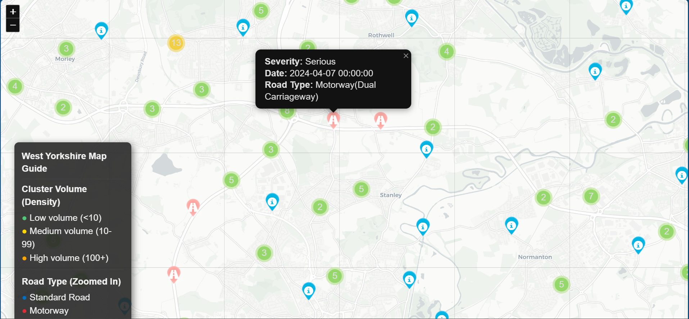

---

## 🗺️ Heatmaps & Regional Visualisation

### Collision Density Heatmap

- Displays collision density using a heatmap overlay, helping identify areas with increased accident concentrations across West Yorkshire.
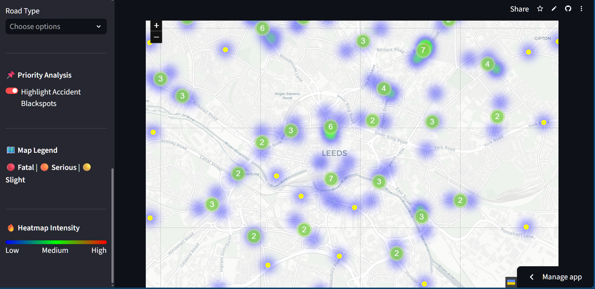

### Regional Collision Overview

- Displays collision cluster distribution across the wider West Yorkshire region, providing a high-level geographical overview of incident activity.
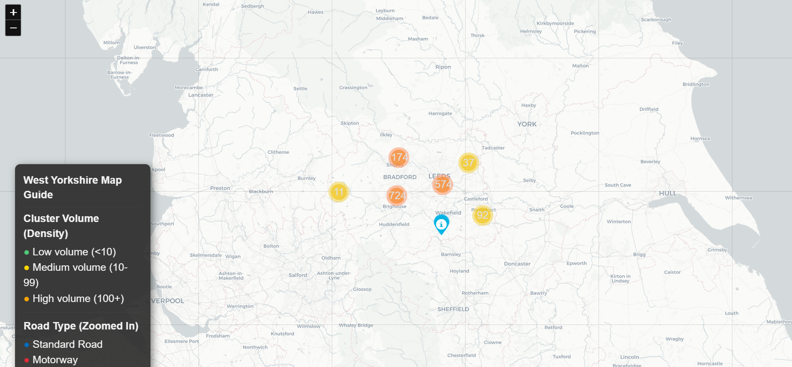

</details>

---

## 🛠️ Project Architecture

This project is divided into two main components to balance real-time interaction with deep-dive analysis:

### 1. Interactive Dashboard (`app.py`)

The "Frontend" of the project. It provides a real-time interface for users to explore the data.
* **Dynamic Geospatial Mapping:** Visualises accident hotspots across Leeds, Bradford, Wakefield, Kirklees, and Calderdale.
* **Instant Filtering:** Filter by Severity (Fatal, Serious, Slight), Year, Weather, and Road Type.
* **Key Metrics:** High-level KPIs that update instantly based on user selection.

### 2. Forensic Reporting Engine (`main.py`)

The "Analytical Backend." This script handles the heavy lifting of data visualisation and document generation.
* **16 Custom Charts:** Generates a comprehensive suite of visualisations (Trend lines, Hourly heatmaps, Vehicle type distributions).
* **Automated PDF Generation:** Compiles all 16 charts into a professional forensic report (`West_Yorkshire_Report.pdf`) for offline review.

---

## 📁 Project Structure

```plaintext
west_yorkshire_traffic_analysis/
├── app.py                 # Streamlit dashboard
├── main.py                # Backend script/Chart generation and PDF generation
├── screenshots/           # Images of charts/Streamlit UI
├── data/                  # CSV data files
├── src/
|   ├── analysis/                 # Analysis suite
|   |       ├── blackspots.py                 
|   |       ├── demographics.py             
|   |       ├── environmental.py           
|   |       ├── geography.py
|   |       ├── infrastructure.py                 
|   |       ├── mapping.py             
|   |       ├── report_generator.py           
|   |       ├── summary_analysis.py
|   |       └── temporal.py               
|   |       
|   ├── map_utils.py      # Geospatial mapping utilities
|   ├── filters.py        # Dashboard filtering logic
|   ├── sidebars.py       # Sidebar filters and returns the user's selections.
│   ├── charts.py         # Chart generation functions
|   ├── mapping.py        # Mapping dictionary
│   └── load_data.py      # Data loading and preprocessing
|
├── tests/                 # Pytest suite
├── .gitignore
├── pyproject.toml         # Project dependencies
├── conftest.py            # Pytest config helper file
├── LICENSE.md.
├── CONTRIBUTING.md
└── README.md              # Project notes
```

---
 
## 📊 Data Sources

This project uses publicly available road safety datasets published by the UK Department for Transport (DfT).

The datasets include: 
- Accident records 
- Vehicle records 
- Casualty records

Data is filtered and analysed for: 
- Leeds 
- Bradford 
- Wakefield 
- Calderdale 
- Kirklees

---

## 🧰 Tech Stack

* **Python 3.10** (Development Environment)
* **Streamlit**: For the web interface.
* **Pandas**: For high-performance data manipulation.
* **Folium/Leaflet**: For interactive geospatial mapping.
* **Matplotlib/Seaborn**: For forensic chart generation.
* **FPDF/ReportLab**: For automated PDF document creation.
* **reverse-geocoder**: For high-speed, offline reverse geocoding of incident       coordinates into human-readable locations.

---

## ⚙️ Installation & Setup

### Clone the Repository

```bash
git clone https://github.com/reory/west_yorkshire_traffic_analysis.git
cd west_yorkshire_traffic_analysis
```

### Create Environment & Install Dependencies

```bash
uv sync
```

### Run the Dasboard

```bash
streamlit run app.py
```

---

## 🧪 Testing 

The project includes automated tests using: 
- pytest 
- pytest-cov 
- Hypothesis 

### Run the full test suite: 

```bash 
pytest
```
---

## 🙏 Acknowledgements
* **Data Source:** UK Department for Transport (DfT) Open Data.
* **Community:** Thanks to the Streamlit and Python communities for the robust library support.
* **Testing:** Special thanks to my family for "Quality Assurance" and bug reporting! 🍻

---

## 🛣️ Roadmap Features

- [x] Interactive Map Layers
- [ ] District Comparison Dashboard
- [ ] Comparative Year Analysis
- [ ] Automated Hotspot Detection
- [ ] Advanced Geospatial Clustering
- [ ] Risk Scoring Engine
- [ ] Historical Trend Forecasting
- [ ] Interactive Time Explorer
- [ ] Export Filtered Results
- [ ] HTML Report Export
- [ ] Offline Desktop Edition

---

**Built By Roy Peters** [Click here for contact details](https://www.linkedin.com/in/roy-p-74980b382/)
